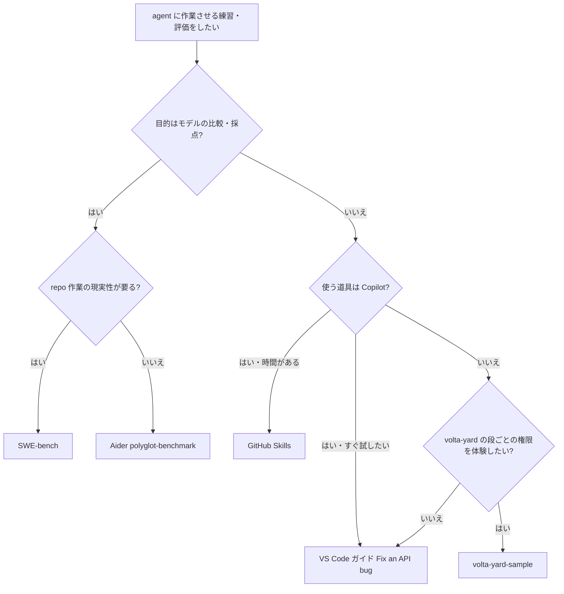

# 市場調査: volta-yard-sample（2026-10-16）

## 0. 要約

- **立ち位置**: volta-yard の「段ごとの権限（観測のみ → 直す → PR）」を初回に体感させる専用の練習台。依存ゼロ・数秒で回り、テストで捕まらない問題を 1 つ含む、という要件の組み合わせを満たす既製品は見つからなかった。**自作を続ける理由はある**。
- **最大の弱点**: **練習台の上流 master が既に「解かれて」いる**。PR #1（2026-09-02 merge）で仕込んだ問題 2 つが直され、clone 直後から `npm test` は 4/4 pass。volta-yard の UI と MCP ツールはこの master を clone させているので、初回体験の第 2 段（「落ちるテストを通す」）が成立しない。
- **次の一手**: 出発点を固定する（PR #1 を revert して出発点にタグを打つ）→ 練習の結果が上流に戻らない形（template repo 化／fork 前提）にする。duration ライブラリとして育てるのはやらない。
- confidence を「中」に留めた理由: 比較対象はリポジトリ構造・README・演習ファイルを読んだが、**演習そのものは実行していない**（GitHub Skills は自分のアカウントに public repo を作ることになり外向きの操作、SWE-bench は Docker イメージのビルドが必要）。

## 1. このrepoは何か

**比較の単位**: この repo は単体では価値を出さない。中身の duration 変換（`src/duration.js` 44 行）はライブラリとしては無価値に近く、**volta-yard ＋ コーディング agent（claude / codex / opencode）＋ 初めて触る人** と組み合わさって初めて意味を持つ。実際に置き換わるのは「duration ライブラリ」ではなく、**「agent 運用基盤の最初の 30 分を体験させる教材」**。したがって比較対象は ms / parse-duration のような同層ライブラリではなく、**agent に作業させる練習台・チュートリアル・評価用の課題セット**とする。

- **一言**: わざと壊した小さな Node.js プロジェクト。volta-yard の「job = 対象 × 段、段ごとに権限」を 3 回の実行で体感させる。
- **提供価値**: 大事な repo に agent を向けずに、(1) 観測のみ段で本当に何も書かれないこと（`git status` が clean）、(2) 直す段の成否がテストで客観的に決まること、(3) PR 段の出力の質、を確かめさせる。テストで捕まらない問題（`parseDuration("banana")` が黙って `NaN`）を 1 つ残し、「コードを読んだか」も判別できる設計。
- **想定利用者**: volta-yard を初めて入れた人。導線は volta-yard 側に 2 か所ある — Web UI のメニュー「練習用の repo を入れる」（`public/assets/app.js` が `git clone https://github.com/opaopa6969/volta-yard-sample.git` を表示）と、MCP ツール説明の「対象が無いなら … を探索先に clone する」（`src/server/mcp-tools.ts:266`）。
- **到達点の客観指標（2026-10-16 実測）**:
  - 追跡ファイル 7、`src` 44 行、テスト 30 行（4 件）、依存 0（`package.json` に dependencies 無し、`node --test` のみ）
  - **出発点 `031703a`**: `npm test` → pass 1 / fail 3（README の記述どおり）
  - **現 HEAD `d535b78`（master）**: `npm test` → **pass 4 / fail 0**。差分は PR #1 の `src/duration.js` +23/−9
  - `parseDuration("banana")` は HEAD でも `NaN`（3 つ目の問題だけは残っている）
  - GitHub: PUBLIC、★0、最終 push 2026-09-02。**リンク先の volta-yard 本体は PRIVATE**
  - README / UI / MCP 説明はいずれも「clone すれば 4 件中 3 件落ちる」前提のまま

README と実態の差がこの文書の出発点になる。README は「出発点」を説明しているが、master は第 3 段（PR 作成）を誰かが実際に走らせ、その PR が上流に merge された後の状態にある（PR #1 の題名「duration: 複合単位のパースと端数を保つフォーマットに直す」は README 第 3 段の指示そのもの）。

## 1.5 調査の型

**`internal`** とした。volta-yard の初回体験専用の部品で、volta-yard 以外から使われる想定が無く（README の主語はすべて volta-yard）、volta-yard 本体も非公開。public であることは「clone できるため」の手段で、外部の利用者を獲りに行く製品ではない。

したがって問いは「どう勝つか」ではなく **「既製の練習台・チュートリアルを流用して、これを作らずに済ませられるか」**。4 節は「うちにあって既製品では満たせない要件」を並べる。

## 2. 比較対象と選定理由

| 製品 | 何ができるか | 採用状況（2026-10-16） | ライセンス | うちとの決定的な違い | なぜ選んだか |
|---|---|---|---|---|---|
| GitHub Skills「Build and test a multi-tier application with GitHub Copilot」 | template repo をコピーし、Actions が各ステップを採点しながら Copilot agent mode で React+Express+MongoDB アプリを作る | ★182 / 最終 push 2026-10-13（雛形 `skills/exercise-template` は ★203） | MIT | **利用者ごとに template からコピー**するので上流が消費されない。所要 90–120 分、Codespaces 前提 | agent 練習台として最も整った既製品。「出発点をどう守るか」の先行例 |
| VS Code agent guide「Fix an API bug」 | 記事のコードを貼って `pagination-bug` を作り、再現 → 回帰テスト → 修正 → レビューを 24 手順で進める | 記事（リポジトリ無し）。docs repo `microsoft/vscode-docs` は ★6,667 | NOASSERTION（docs repo） | **既存テストは通るのにバグがある**構造はうちと同じ。ただし「まだ編集しないで」は**プロンプトでのお願い**で、権限としては強制されない | 設計思想が最も近い。うちの「権限は強制」という主張の対照になる |
| Aider polyglot-benchmark | Exercism 由来の 225 課題（6 言語）。スケルトン＋テストで agent を採点 | ★223 / 最終 push 2024-12-22 | GitHub API 上 license 無し | 量と採点が目的。課題は「未実装の関数を埋める」パズルで、repo 作業ではない | 「テストで合否が決まる課題」を agent に解かせる代表例 |
| SWE-bench | 実 OSS の issue を base commit に固定し、Docker で FAIL_TO_PASS テストを採点。Verified 500 問 | ★6,033 / 最終 push 2026-09-18 | MIT | **出発点を commit と Docker イメージで厳密に固定**。重い（Docker 必須） | 「agent に repo 作業をさせて評価する」事実上の標準 |

**地図の読み方**: この分野は 2 系統に割れていると読める。一方は **「モデルを測る」ベンチマーク**（polyglot / SWE-bench）で、量・再現性・採点が価値。もう一方は **「道具の使い方を教える」チュートリアル**（GitHub Skills / VS Code ガイド）で、手順の分かりやすさが価値。どちらも「agent に何を許すか（権限）を段階的に広げる」ことを主題にしていない — VS Code ガイドは read-only をプロンプトで頼むだけで、GitHub Skills はステップが学習内容の区切りであって権限の区切りではない。**うちの主題は空いている**が、それは需要が無いからかもしれない点には注意（5.5 節）。

## 4. 機能比較（`internal` なので「うちにあって既製品で満たせない要件」）

| 要件 | 重み | うち | GitHub Skills | VS Code ガイド | polyglot | SWE-bench |
|---|---|---|---|---|---|---|
| 段の区切り＝権限の区切り（観測のみ → 直す → PR）に沿った課題構成 | ◎ | ○ | × | △（プロンプトで頼むだけ） | × | × |
| テストで捕まらない問題を含み「読んだか」が分かる | ◎ | ○ | 未確認 | ○ | × | × |
| **clone 直後に出発点にいる**（上流が消費されない） | ◎ | **×（現状）** | ○（template コピー） | △（自分で貼って commit） | ○ | ○（base commit 固定） |
| 依存ゼロ・数秒で回る | ○ | ○（依存 0、テスト 47ms） | ×（Codespaces、npm 依存 27） | ○（組み込みモジュールのみ） | △（課題ごとに devDeps 9） | ×（Docker） |
| agent を選ばない（claude / codex / opencode で見比べ） | ○ | ○ | ×（Copilot 前提） | ×（Copilot 前提） | △（Aider の harness 前提） | ○ |
| 段の合否を自動判定 | ○ | △（第 2 段のみテストで客観、1・3 段は人が読む） | ○（Actions の `grade-step.mjs`） | × | ○ | ○ |
| 複数対象で「段の間にバリアが無い」を体験できる | ○ | × | × | × | ○（課題が多数） | ○（課題が多数） |
| volta-yard から 1 クリックの導線 | ○ | ○（UI と MCP 説明） | × | × | × | × |
| 日本語の説明 | △ | ○ | 未確認 | 未確認 | × | × |

凡例: ○=ある / △=部分的・要設定 / ×=無い / 未確認=今回確かめていない ／ 重み: ◎=この立ち位置で必須 / ○=効く / △=あれば良い

**読み方**: 自作の正当性は最初の 2 行（◎）にある — 権限の段に沿った構成と「テストに無い問題」の組み合わせは、既製品のどれも満たしていない。VS Code ガイドは 2 行目を満たすが 1 行目を満たさず、むしろ「read-only がプロンプト頼み」という、うちの README が対比に使っている状態そのもの。
一方で **3 行目（◎）の × が最も痛い**。既製品は全部、何らかの方法で出発点を守っているのに、うちだけが守っていない。これは機能不足ではなく運用事故で、直すコストは小さい。
依存ゼロ・agent 非依存は差別化として効いているが、VS Code ガイドも依存ゼロなので「軽さ」単独では差にならない。7 行目（複数対象）の × は、README が「対象が複数あれば…すぐ第 2 段に進む」と書きながら練習台が 1 つしか無い、という README 内部の不整合でもある。

## 4.5 コード・実装の比較

| 観点 | うち | GitHub Skills | VS Code ガイド | polyglot | SWE-bench | 出典 |
|---|---|---|---|---|---|---|
| 規模 | 7 ファイル / src 44 行 | 64 ファイル | 1 ファイル（記事から貼る） | 225 課題 | Verified 500 問 | `git ls-tree` / GitHub tree API / 記事 / README |
| 依存 | 0 | backend 4+9 dev、frontend 6+8 dev | 0（Node 22 組み込み） | 課題あたり devDeps 9（bowling で確認） | Docker + Python harness | 各 `package.json` / 記事 / README |
| テスト | 4 件（出発点 1 pass/3 fail、HEAD 4 pass） | contract テスト 3 ファイル＋Actions 採点 | 2 件（両方 pass、バグは未検出） | 課題ごとの spec（隠しテスト） | FAIL_TO_PASS / PASS_TO_PASS | `npm test` 実行 / tree / 記事 / README |
| 出発点の固定方法 | **無し**（README の「やり直す」は手元の変更を捨てるだけ） | template repo（`is_template: true`）から利用者ごとにコピー | 利用者が最初に commit | スケルトンを harness がコピー | base commit + Docker イメージ | README・API・記事 |
| ライセンス | MIT | MIT | NOASSERTION | 無し | MIT | GitHub API |

**前提の違い**: 既製品はどれも「課題の上流は読むだけ、作業は利用者のコピーで」という前提を置いている。うちは「clone して、手元で壊して、`git checkout -- .` で戻す」前提で、**第 3 段（push・PR）が上流そのものに向かう**ことを想定していなかった。第 3 段は権限として push と PR を許すので、PR が上流に立ち、誰かが merge すれば出発点は消える — 今回それが実際に起きた。GitHub Skills が template コピーを採っているのは、まさにこれを避けるためだと読める。

## 5. 採用状況

図は描かない。star 数は揃うが、うちは非公開製品の付属物で ★ を獲る立場になく、VS Code ガイドは記事なので star を持たない（docs repo の ★ はこのガイドの採用度ではない）。並べても判断材料にならない。

## 5.5 調査者の見立て

**本当の勝負所**は 1 点で、「clone した瞬間に、README どおりの出発点にいるか」だと思う。この repo の価値は初回体験の再現性にすべて乗っていて、機能表の他の行はそれが成立した後の話。今は volta-yard の UI から案内された人が clone すると 4/4 pass の repo を受け取り、第 2 段の指示「落ちているテストを通して」が空振りする。agent は「既に通っている」と報告するか、勝手に別のことを始めるだろう（推測）。初回体験で起きるとすれば最悪の種類の失敗で、「yard は動かない」と受け取られかねない。

**数字に出ていないが気になること**: (1) この事故は、練習台の README 第 3 段が「commit して PR を出す」と上流向けの操作を促していること、そしてそれを受けた誰か（PR #1 の author・merger はどちらも作者アカウント `opaopa6969`。人が操作したのか、そのアカウントで動く agent なのかは記録から区別できない）が普段の「PR は merge まで」の運用どおり merge したことの組み合わせで起きたと読める。**運用の規範（何でも merge まで）と練習台の性質（解いてはいけない）が衝突している**ので、仕組みで止めないとまた起きると思う。(2) README のリンク先 volta-yard は PRIVATE で、外の人にはリンクが 404 になる。public な練習台が private な本体を指している状態は、公開範囲の判断が済んでいないことの表れに見える（ここは公開範囲の判断なので提案には入れず、事実として残す）。(3) 「テストに無い問題」が仕込みの NaN 1 つだけなので、2 回目以降は答えを知っている人が多くなり、第 1 段の判定力が落ちていく。

**自分ならどうするか**: duration には一切手を入れず、**出発点を不変にする仕組み**だけを入れる。具体的には出発点に `start` タグを打ち、master をその状態に戻し、template repo にして「上流は読むだけ」を構造で保証する。教材の中身を増やすのはその後でよい。

**この見立てが外れるとしたら**: (a) volta-yard の利用者が実際には作者 1 人で、初回体験を誰も通らないなら、出発点が壊れていても実害は無く、優先度は下がる。(b) volta-yard 側が clone 時に `031703a` を checkout するよう変われば、上流 master の状態は問題でなくなる（現状のコードはそうしていない）。(c) 権限の段を体験させる教材が GitHub Skills や VS Code から出れば、「既製品で満たせない要件」の 1 行目が消え、自作の正当性が薄れる。

## 6. 提案（優先順）

| 順 | 提案 | 分類 | 根拠 | 最小の一手 | 効きそうな指標 |
|---|---|---|---|---|---|
| 1 | **出発点を取り戻して固定する** | 埋める | 4 節 3 行目（◎）が ×。HEAD で 4/4 pass、出発点 `031703a` で 1/3 | PR #1 を revert する PR を出し、出発点 commit に `start` タグを打つ。README の「やり直す」を `git checkout start -- .` 系に直す | clone 直後の `npm test` が pass 1 / fail 3 |
| 2 | **練習の結果が上流に戻らない形にする** | 埋める | 4.5 節。既製品はすべて「上流は読むだけ」。今回の事故の原因は第 3 段が上流に PR を立てられること | GitHub の template repo 設定を有効にし、volta-yard の UI/MCP の案内を「template から自分の repo を作る」か「fork してから clone」に変える。README 第 3 段に「この PR は merge しない」と明記 | 上流 master への練習 PR の merge が 0 件 |
| 3 | **段の合否判定を volta-yard 側に持たせる** | 伸ばす | 4 節「段の合否を自動判定」が △。第 1 段（NaN に触れたか）・第 3 段（なぜ間違っていたかを書いたか）が人の目視頼み | 判定基準は**この repo に置かない**（第 1 段の agent が読んで答えを知ってしまう）。volta-yard の Judge／reality-check-loop 側に期待所見を持たせる | 第 1〜3 段の判定が人手無しで出る |
| 4 | **練習台を 2 つ目以降も用意する（複数対象の体験用）** | 埋める | 4 節 7 行目。README は「対象が複数あれば…」と書くが対象が 1 つしか無い | 規模の違う 2 つ目の小さな練習台を用意する（同じ repo を 2 回 clone しても所要が揃ってしまい「遅い対象を待たない」が見えない） | 1 job で段の進み方が対象ごとにずれるのが画面で見える |
| — | **やらない: duration ライブラリとして育てる**（TODO の `w`/`mo` 単位、NaN の扱いを上流で決める等） | やらない | ms / parse-duration 系は既に存在し車輪の再発明。加えて、**上流で問題を解くこと自体が練習台の消費**で、今回の事故と同じことを繰り返す。TODO.md の項目は「agent に解かせる追加の題材」として残すのが役目 | TODO.md の冒頭に「これは練習の題材。上流では解かない」と 1 行書く | — |
| — | **やらない: ベンチマーク化**（課題を数十に増やす、採点 harness を作る） | やらない | 2 節のとおり、モデルを測る側は SWE-bench（★6,033）・polyglot が既に押さえている。うちの価値は「数秒で終わり、壊して安全な初回体験」で、量を増やすとその軽さを失い、volta-yard の教材ではなくモデル評価になる | — | — |

## 7. 選択の分岐

4 節の要件表から引いた分岐。

volta-yard を使わない人にとって、この repo を選ぶ理由は無い。それで正しい — 単体では価値を出さない部品なので。

## 8. 出典

| URL | 参照日 | 何の根拠に使ったか |
|---|---|---|
| 自 repo `README.md` / `TODO.md` / `src/duration.js` / `test/duration.test.js` / `package.json`（commit d535b78） | 2026-10-16 | 1 節の機能・規模・依存 0 |
| 自 repo で `npm test` を実行（HEAD d535b78 と出発点 031703a の両方。031703a は一時ディレクトリに取り出して実行） | 2026-10-16 | HEAD 4 pass / 出発点 1 pass 3 fail、`parseDuration("banana")` が両方で NaN |
| `gh repo view` / `gh pr list` on opaopa6969/volta-yard-sample | 2026-10-16 | PUBLIC・★0・PR #1 が 2026-09-02 に merge |
| `gh repo view opaopa6969/volta-yard` | 2026-10-16 | volta-yard が PRIVATE |
| volta-yard `public/assets/app.js`・`public/assets/i18n/{en,ja}.js`・`src/server/mcp-tools.ts:266`（ローカル clone 0bd7c29） | 2026-10-16 | 練習台への導線 2 か所と、master を clone させていること |
| https://github.com/skills/build-applications-w-copilot-agent-mode （README とファイルツリーを読んだ。GitHub API） | 2026-10-16 | ★182・MIT・template・64 ファイル・Actions 採点・所要 90–120 分・依存数 |
| https://github.com/skills/exercise-template （GitHub API） | 2026-10-16 | ★203・template 雛形 |
| https://code.visualstudio.com/docs/agents/guides/overview | 2026-10-16 | VS Code のガイド一覧 |
| https://code.visualstudio.com/docs/agents/guides/fix-a-bug-with-agents | 2026-10-16 | 貼り付けで作るサンプル・既存 2 テストが通るのにバグ・read-only はプロンプト頼み・24 手順・リセット手順無し |
| https://github.com/microsoft/vscode-docs （GitHub API） | 2026-10-16 | docs repo の ★6,667・NOASSERTION |
| https://github.com/Aider-AI/polyglot-benchmark （ツリーと `javascript/exercises/practice/bowling/` のスケルトン・package.json を読んだ） | 2026-10-16 | ★223・license 無し・言語別課題数（計 225）・devDeps 9 |
| https://aider.chat/2024/12/21/polyglot.html | 2026-10-16 | polyglot の位置づけ（697 問中 225 問、2 回目の試行で採点） |
| https://github.com/SWE-bench/SWE-bench （README を読んだ。GitHub API） | 2026-10-16 | ★6,033・MIT・Docker で再現・Verified 500 問 |

## 9. 前回からの差分

前回の文書は見つからなかった。探した範囲: この repo の `docs/market/`（全ブランチの履歴に market を含むパス無し）、issue-hub の「volta-yard-sample」を題名に含む issue（0 件）。今回が初回調査にあたる。
